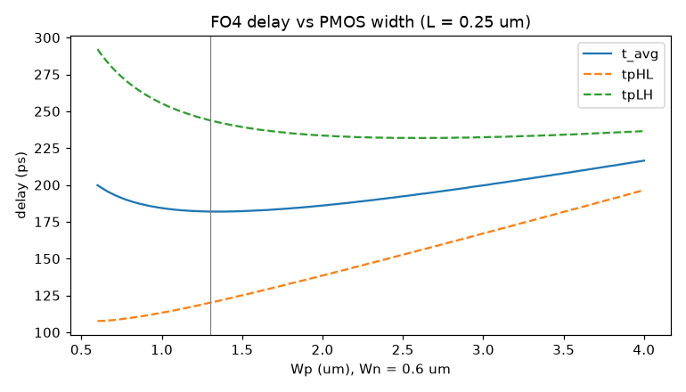
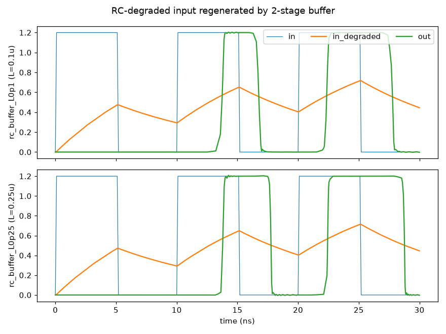
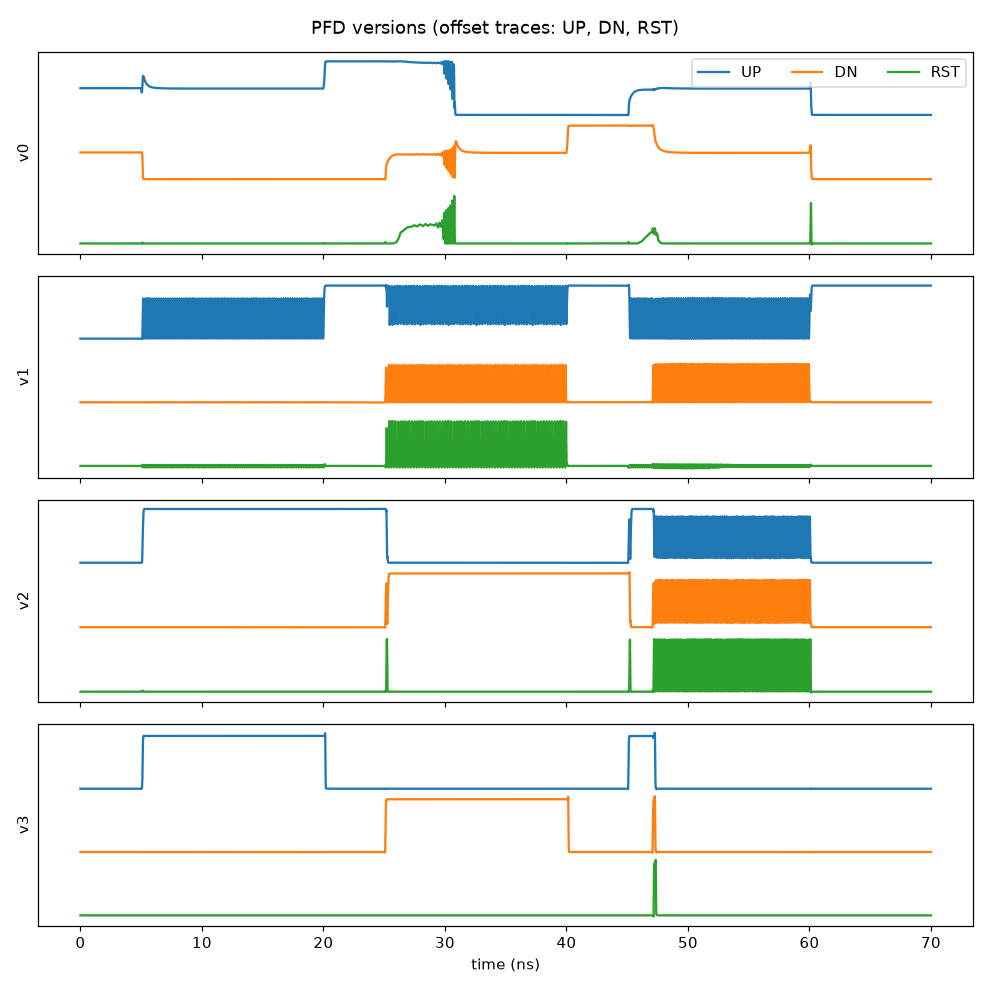

# HSPICE practice decks (2026-09 – 2026-10)

這裡是 lab 講義之外的 11 份自主練習網表。本次以 HSPICE S-2021.09 重新模擬每一份，依電路類型分成 5 類，量測結果與判讀如下。量測腳本在 [`scripts/`](scripts)，數值在 [`results/summary.json`](results/summary.json)，圖在 [`results/figures/`](results/figures)。

模型與 lab 相同，使用另行提供的 `nmos`／`pmos` 函式庫，不隨 repo 上傳。網表中的 `* MODEL_SETUP_REQUIRED` 是模型載入位置。

## 分類

| 類別 | 網表 | 原始檔名 | 內容 |
| --- | --- | --- | --- |
| 01 AND 閘 glitch | [and_glitch_4versions.sp](01_and_gate_glitch/and_glitch_4versions.sp) | `20260902.sp` | NAND+INV 構成 AND，四個版本並列：原始、加大 PMOS、輸出節點 3 fF 電容、快速輸入邊緣 |
| 02 FO4 延遲 | [fo4_wp_sweep_L0p25.sp](02_fo4_delay/fo4_wp_sweep_L0p25.sp) | `20260903.sp` | L=0.25 µm、Wn=0.6 µm，Wp 由 0.6 掃到 4.0 µm（171 點），找最小平均延遲 |
| | [fo4_tpd_L0p1.sp](02_fo4_delay/fo4_tpd_L0p1.sp) | `2026091702.sp` | L=0.1 µm、Wp/Wn=1.2/0.6 µm 的 FO4 單點延遲 |
| 03 RC 長導線與 buffer | [rc_buffer_L0p1.sp](03_rc_wire_buffer/rc_buffer_L0p1.sp) | `20260917.sp` | 20 kΩ／500 fF 導線（τ=10 ns）後接兩級反相器，L=0.1 µm |
| | [rc_buffer_L0p25.sp](03_rc_wire_buffer/rc_buffer_L0p25.sp) | `2026091703.sp` | 同上電路，L=0.25 µm |
| 04 PFD | [pfd_v0_tg_dff.sp](04_pfd/pfd_v0_tg_dff.sp) | `20260908_pfd.sp` | 傳輸閘 master–slave DFF，NOR 重置 |
| | [pfd_v1_or_reset_dff.sp](04_pfd/pfd_v1_or_reset_dff.sp) | `20260908_pfd_01.sp` | master 端改 INV+OR 重置，加 `.ic` |
| | [pfd_v2_tg_latch_dff.sp](04_pfd/pfd_v2_tg_latch_dff.sp) | `20260908_pfd_02.sp` | 每級改為 NOR+INV 偶數級回授鎖存 |
| | [pfd_v3_6nand_dff.sp](04_pfd/pfd_v3_6nand_dff.sp) | `20260908_pfd_03.sp` | 6-NAND 邊緣觸發 DFF，重置路徑加兩級延遲 |
| 05 NMOS 類比 | [rc_phase_shift_osc.sp](05_nmos_analog/rc_phase_shift_osc.sp) | `20261020.sp` | 單顆 NMOS + 三節 RC 相移振盪器，VDD=2.5 V |
| | [cs_amp.sp](05_nmos_analog/cs_amp.sp) | `202610201.sp` | 共源放大器，Vgs=1.0 V＋10 mV 10 kHz 正弦 |

## 結果與判讀

### 01 AND 閘 glitch

| 版本 | 20 ns 附近峰值 | glitch 寬度（50%） | b→out 上升延遲 | b→out 下降延遲 |
| --- | --- | --- | --- | --- |
| 原始 | 1.037 V | 108 ps | 38.7 ps | 44.9 ps |
| Sol 1：Wp=3.0 µm | 1.018 V | 98 ps | 43.9 ps | 37.6 ps |
| Sol 2：3 fF | 1.033 V | 109 ps | 43.8 ps | 49.8 ps |
| Sol 3：0.01 ns 邊緣 | 0.021 V | 無 | 22.7 ps | 26.9 ps |

glitch 不是電路缺陷，是刺激造成的：20 ns 時 b 在 20.0–20.1 ns 上升，a 在 20.1–20.2 ns 才下降，兩者 50% 點重疊約 100 ps，這段期間 a·b 本來就是 1。所以加大 PMOS 或在輸出節點加 3 fF，都消不掉滿擺幅的 glitch。Sol 3 有效，是因為重疊縮到約 10 ps，閘延遲把它濾掉了。實際電路要消 hazard，應該對齊輸入時序或改用同步取樣，而不是調整閘的尺寸。

### 02 FO4 延遲

- **Wp 掃描（L=0.25 µm）**：最小平均延遲出現在 Wp=1.30 µm，即 Wp/Wn≈2.17，t_avg=181.9 ps（tpHL 120.1 ps、tpLH 243.8 ps）。Wp=0.6 µm 時為 199.8 ps，4.0 µm 時為 216.5 ps。此網表的負載反相器也一起放大，所以這是含自身負載的 FO4 最佳化。
- **單點（L=0.1 µm，Wp/Wn=2）**：tpHL 23.3 ps、tpLH 31.3 ps、tpd 27.3 ps。
- `.option numdgt=8` 不會增加 `.mt0` 的位數，`.mt0` 仍只有 4 位有效數字。要更多位數，請用 `measdgt`。



### 03 RC 長導線與 buffer

| L | 20–30 ns 導線端擺幅 | buffer 輸出 | in→out 上升延遲（50%） |
| --- | --- | --- | --- |
| 0.1 µm | 0.404–0.718 V | 0–1.20 V | 2.32 ns |
| 0.25 µm | 0.404–0.715 V | 0–1.20 V | 2.39 ns |

導線 τ=10 ns，等於輸入週期，導線端只剩約 0.31 V 的擺幅，而且直流位準還在上升。兩級 buffer 能把它還原成滿擺幅，但第一個脈衝在 0.47 V 就沒過門檻而被吃掉，後面的脈衝寬度也變了。這是 RC 造成的 ISI，buffer 只能還原擺幅，救不回時序。L 從 0.1 µm 改成 0.25 µm，結果差異很小。

原始 `2026091703.sp` 的第一行就是 `.inc`。HSPICE 會把第一行當標題，結果模型沒載入，模擬以 `pmos`／`nmos` 未定義的錯誤中止。公開版本在最前面補了一行 `.title`，電路內容不變。



### 04 PFD

理想行為：5 ns phi_in 上升，UP=1；25 ns phi_fb 上升，兩者同時為 1 後重置，回到 0/0；45 ns UP=1，47 ns 重置。其中 25–40 ns 不應該出現 DN=1。原網表註解寫「25–40 ns DN=1」，這跟 PFD 的定義不符。

| 版本 | 15 ns UP／DN | 35 ns UP／DN | 55 ns UP／DN | RST 脈衝數 | 判定 |
| --- | --- | --- | --- | --- | --- |
| v0 TG DFF | 0.49／0 V | 0／0.49 V | 0.49／0.49 V | 7 | 輸出停在半電位，30 ns 附近振盪，不正常 |
| v1 OR 重置 | 振盪 | 振盪 | 振盪 | 65 | 5–60 ns 大量振盪（UP 225 次上升） |
| v2 偶數級鎖存 | 1／0 V | 0／1 V | 0.73／0.73 V | 80 | 25 ns 重置後 DN 被重新鎖成 1；47–60 ns 重置迴路振盪 |
| v3 6-NAND | 1／0 V | 0／1 V | 0／0 V | 1 | 不振盪，47 ns 重置正確（178.6 ps）；但 UP 在 20 ns、DN 在 40 ns 跟著輸入下降而歸零 |

v3 最接近能用，但它的 DFF 在 D=VDD 時，輸出會跟著 CLK 的電位走，不是邊緣觸發。所以 25 ns 時 UP 已經是 0，碰不到重置條件。四版都還不是正確的 PFD。下一步應先單獨驗證 DFF：確認 D=1 時 Q 只在 CLK 上升緣改變、CLK 下降時保持，再接回 PFD。



### 05 NMOS 類比

兩份網表的偏壓都落在線性區：W=10 µm 搭配 Rd=10 kΩ，Vds 只有 19–43 mV。

- **相移振盪器**：DC 工作點 Vgs=0.607 V、Vds=42.9 mV、gm=1.08 mS、gds=4.98 mS。迴路增益約 gm·(Rd‖ro)≈0.21，遠小於三節 RC 起振需要的約 29。輸出峰對峰值從前 0.5 ms 的 1.38 mV，衰減到 2.5–3 ms 的 0.2 µV，不起振。
- **共源放大器**：Vgs=1.0 V、Vds=18.6 mV、gm=234 µS、gds=13.1 mS。輸入 20 mV pp，輸出 0.355 mV pp，增益 0.0178 V/V，與 gm·(Rd‖ro)=0.0178 相符，是衰減器而不是放大器。

要讓 MOS 進入飽和區，需降低 Rd·Id（減小 W 或 Rd，或降低 Vgs），使 Vds > Vov。

## 重新執行

```text
python scripts/run_practice.py LOCAL_RUN_DIRECTORY --model LOCAL_MODEL --simulator HSPICE_EXECUTABLE
python scripts/analyze.py LOCAL_RUN_DIRECTORY
```

`run_practice.py` 只在執行副本中把 `* MODEL_SETUP_REQUIRED` 換成模型 `.include`，並寫出 `run_manifest.json`。執行目錄請放在 repo 外。`analyze.py` 會重寫 `results/summary.json` 與 `results/figures/`。

## 與原始檔的差異

[`results/source_manifest.json`](results/source_manifest.json) 記錄每份原始檔的 SHA-256 與修改內容：

- 模型載入行換成 `* MODEL_SETUP_REQUIRED`。
- `.option post=3` 改成 `post=2`（ASCII 波形，供腳本量測）。
- `rc_buffer_L0p25.sp` 補上標題行。

電路、尺寸與刺激都沒有更動。原始 `.tr0` 波形在量測後即刪除，SHA-256 與大小記錄在 [`results/run_receipts.json`](results/run_receipts.json)。
